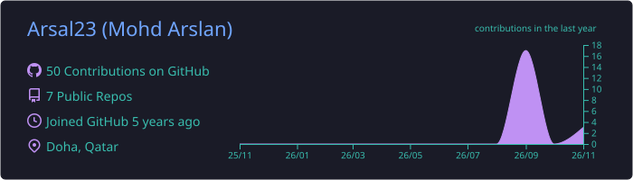
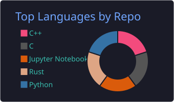
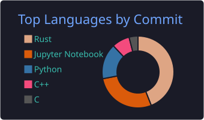
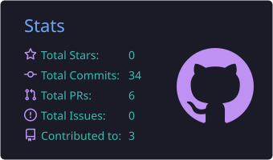
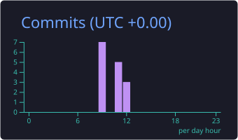

<h1 align="center">Hi 👋, I'm Mohd Arslan</h1>
<h3 align="center">Engineer building local-first AI tools, smart systems & high-performance software</h3>

  
  

---

### 🚀 About me

- 🤖 I build **privacy-first AI apps** that run fully on your own machine (no cloud, no API keys)
- 🧠 Working with **LLMs, RAG, AI agents and on-device speech recognition** (Whisper, Ollama, LangChain, FAISS)
- 📡 Background in **IoT, ELV and smart-building systems**: connecting hardware, networks and software
- ⚙️ Interested in **compilers, systems programming and verifiable computation**
- 🌱 Currently exploring **Rust for desktop apps** and **multi-agent AI routing**
- 📍 Based in **Doha, Qatar**
- 💬 Open to collaborating on **open-source AI tools**. Feel free to open an issue or say hi!

---

### 🛠️ Tech stack

**Languages**

**AI / ML**

**Web & Tools**

---

### ⭐ Featured projects

| Project | What it does | Stack |
|---|---|---|
| 🎙️ [**VoiceFlow**](https://github.com/Arsal23/VoiceFlow) | Hold a hotkey, speak, and clean text lands at your cursor. On-device Whisper transcription + local Ollama cleanup, per-app writing styles. 100% offline. | Rust · Whisper · Ollama |
| ✈️ [**SmartTravelAI**](https://github.com/Arsal23/SmartTravelAI) | AI travel assistant with an agent router that sends each query to RAG, tools or the LLM, with guardrails, structured logging and a full test suite. | Python · FastAPI · LangChain · FAISS · React |
| ⚡ [**Intermittent Computation**](https://github.com/Arsal23/Compiler-Directed-High-Performance-Intermittent-Computation-with-Power-Failure-Immunity) | Compiler-directed techniques that let programs survive power failures on energy-harvesting devices. | Python · Jupyter |
| 🔐 [**Verifiable Computation**](https://github.com/Arsal23/Non-Interactive-Varifiable-Computation) | Client/server system where a client can verify results computed by an untrusted server without interaction. | C++ · Cryptography |
| 🗣️ [**English → SQL Parser**](https://github.com/Arsal23/GUI-English-to-SQL-parser) | GUI tool that turns plain-English questions into SQL queries. | C · Compilers |

---

### 📊 GitHub stats

  

  
  

  
  

---

  ⭐ If you find my projects useful, consider giving them a star and <a href="https://github.com/Arsal23?tab=followers"><b>following me</b></a> for more local-first AI tools!

